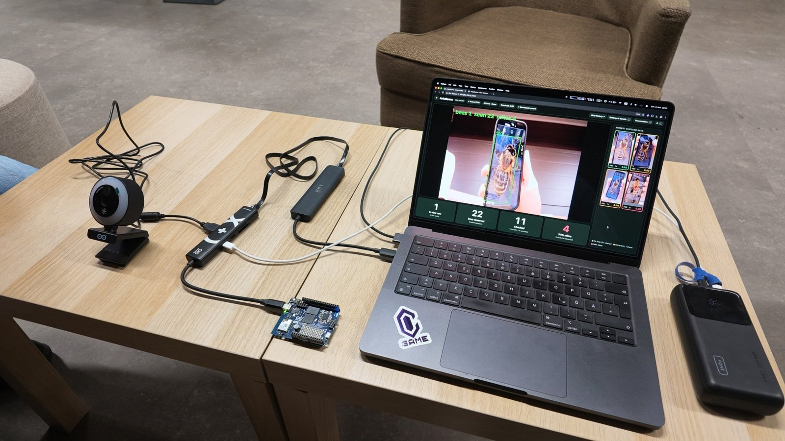
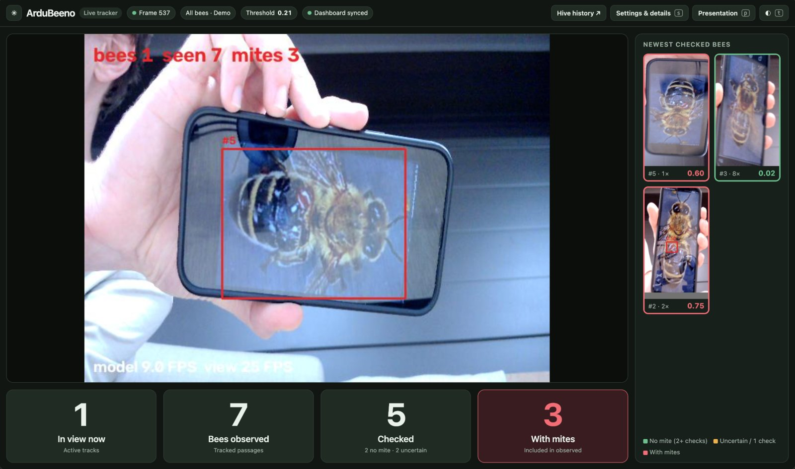
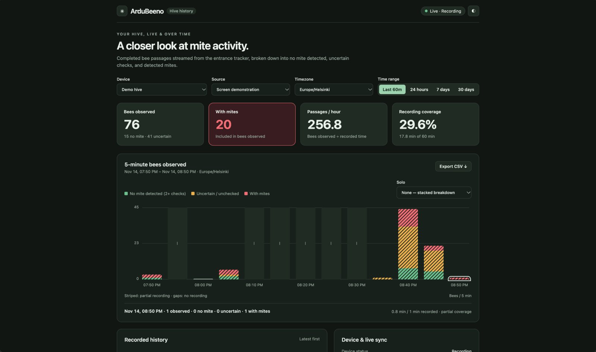

# ArduBeeno: a mite check for every bee at the hive entrance

ArduBeeno is a small camera and a credit-card-sized computer, the Arduino UNO Q, placed at the entrance of a
beehive. It watches the bees walk in and out, checks every single one for Varroa mites, and keeps count: how many
bees it saw, and how many of them carried a mite. It does all of this by itself, on the spot, without sending
pictures anywhere and without needing the internet.


*Our test setup: the USB camera (left) and the Arduino UNO Q (front) on a USB hub. The laptop shows the board's live
page while a bee picture on a phone is held in front of the camera.*

Built in one weekend at Junction 2026 (track "The Green European Renaissance", challenge "Best use of Arduino Uno Q")
by a team from 42 Heilbronn.

## Why this matters

The Varroa mite is the biggest threat to honeybees. The mites are about the size of a pinhead, they ride on the bees
like ticks, weaken them and spread diseases. A colony that isn't treated in time usually dies.

To know when to treat, a beekeeper has to find out how many bees carry mites. Today that means opening the hive,
scooping out a few hundred bees and shaking them in powdered sugar or washing them in alcohol, which kills them.
It takes time and disturbs the colony, so it is done only now and then, and each test shows just one moment.

ArduBeeno turns this around: the bees come to the camera on their own, many times a day. The beekeeper gets a
running picture of the colony's health without opening the hive and without harming a single bee.

## How it works, step by step

1. **Watch.** The camera films the hive entrance, about 25 pictures a second.
2. **Spot the bees.** The board finds every bee in the picture, even when several walk past at once.
3. **Follow each bee.** It keeps track of each bee while it crosses the picture, so every bee is counted once per
   visit, not once per picture.
4. **Take a close look.** For each bee, the board cuts out a close-up and checks it for mites. First it takes a
   quick look; only if it isn't sure does it take a second, slower and more careful look that searches for the mite
   itself.
5. **Make up its mind.** One picture can be blurry or show the wrong side of the bee, so the board looks at each bee
   several times. It calls a bee infested only after it has seen the mite at least twice (or once very clearly), and
   clean only after two good looks without a mite. Everything in between is marked "uncertain" instead of guessed.
6. **Tell you.** The result shows up in three places:
   - **The board's own LED display** shows the number of mites counted so far, and flashes a mite symbol while an
     infested bee is in view.
   - **A live web page** from the board shows the camera picture with a frame around every bee (red when it has a
     mite), the counts, and close-ups of the checked bees with the mite marked.
   - **A dashboard** on a laptop or server (optional) shows bees and mites over hours and days. If the connection
     drops, the board keeps its own record and sends it once it is back.


*The live page from the board. The bee in the red frame was judged infested; below are the counts (bees in view,
bees observed, bees checked, bees with mites), on the right the close-ups of the latest checked bees with their mite
score (red: mite, green: clean).*


*The dashboard on the laptop: everything the board recorded in the last hour, in 5-minute steps. Green: no mite,
amber: uncertain, red: with mites. Striped bars mark times when the board recorded only part of the time.*

The "looking" is done by small artificial-intelligence models that we trained on thousands of bee pictures: some with
mites, some without. They are small enough to run on the board itself, so no picture ever leaves the hive.

We built it in two steps: first a model that checks a close-up of a single bee for mites, then a second model that
finds the bees in the camera picture and cuts out those close-ups for the first. How and why:
[docs/APPROACH.md](docs/APPROACH.md).

## How good is it?

So far we have tested it with bee pictures shown on a laptop screen and filmed by the camera; it has not been at a
real hive yet. In that test:

- **Of every 100 bees carrying a mite, it finds about 93.**
- **About 4 of 5 alarms are real**; the fifth is a clean bee it mistook for an infested one.
- **It checks a bee in about a sixth of a second**, on the board itself.

Its main weakness: a mite hidden under a wing is often missed, because the camera simply can't see it. The next
step is filming real hive entrances, so that the models learn from what a real camera sees there.

## Technical overview

The UNO Q has two processors: a Linux computer (Qualcomm QRB2210, 4 Cortex-A53 cores) that runs the camera and the
models, and a microcontroller (STM32) that drives the LED matrix. All models are YOLO11-nano networks, exported to
ONNX, quantized to int8 and run on the CPU with onnxruntime.

```
USB camera, 1280x720
   |
   v
bee detector (bees.onnx, every 3rd frame) --> tracker: one ID per bee, boxes move on between detections
   |
   v
crop of each bee, upright, 160x280 (the mite models' training size)
   |
   v
mite classifier (varroa_cls.onnx) ----- sure? --> clean / mite
   |  unsure
   v
mite detector (varroa.onnx): finds the mite, decides together with the classifier
   |
   v
bee = MITE after 2 positive checks --> LED matrix, live page (port 7000), local history --> dashboard (port 8000)
```

- The classifier decides alone for 89% of the camera test bees; only the rest also go through the detector.
- The mite models were trained on the [VarroaDataset](https://zenodo.org/records/4085044) and fine-tuned on bees
  filmed through a camera. The bee detector was trained on public hive and landing-board images, camera recordings
  and synthetic bees, with everyday photos as negatives.

| Measure | Value |
|---|---|
| Camera test set (3,600 bees), deployed models | recall 0.926, precision 0.801, F1 0.859 |
| Original photo test set (3,408 bees), same models | F1 0.873 |
| Before the camera fine-tune: photo / camera test set | F1 0.901 / 0.725 |
| On the board: live view / bees processed | ~25 / ~5 frames per second |
| On the board: mite check per bee / bee detector run | ~140-165 ms / ~0.5 s |
| Mites under a wing / visible mites found | about 55-65% / about 95% |

Thresholds are chosen on the validation set and applied once to the test set; the test videos are used for nothing
else. Bigger classifiers (ConvNeXt, DINOv2) were not better. All experiments: [docs/RESULTS.md](docs/RESULTS.md).

## Getting started

### Run it on the board

You need an Arduino UNO Q with [Arduino App Lab](https://docs.arduino.cc/software/app-lab/), a USB camera (through a
powered USB-C hub if needed), SSH access to the board, and the trained models in `export/`. The models are not in
git: train them (below) or ask us for the ONNX files.

```sh
make applab                                  # copy the models and their settings into applab/ardubeeno/python/
make applab-push BOARD=arduino@<board>       # copy the app to ~/ArduinoApps/ardubeeno on the board
```

Then open App Lab, pick **ArduBeeno Varroa** under My Apps and press Run. The first start compiles the LED-matrix
sketch and downloads App Lab's Python container, which takes a few minutes. Open `http://<board>:7000` for the live
page. Over a direct cable, use the board's name (ours is `ardu-bee-no.local`) rather than its 169.254.x.x address.

- The LED matrix only works when the app runs in App Lab. `serve.py` runs the same page without App Lab (and without
  the matrix); don't run both at once, they compete for the camera and port 7000.
- `make applab-local` runs the same app on your laptop's webcam: `http://localhost:7000`.

### Add the dashboard (optional)

Create the dashboard's venv (see [dashboard/README.md](dashboard/README.md)) and two local config files with the
same token; both are .gitignored:

- `demo/receiver.env`: `ARDUBEENO_DEVICES_JSON='{"uno-q-01":{"name":"Hive 01","timezone":"Europe/Helsinki","token":"<long random token>"}}'`
  and `ARDUBEENO_DB=dashboard/var/receiver.sqlite3`
- `demo/ardubeeno.env`: `ARDUBEENO_SERVER_URL=http://<laptop-ip>:8000`, `ARDUBEENO_DEVICE_ID=uno-q-01`,
  `ARDUBEENO_DEVICE_TOKEN=<the same token>`, optionally `ARDUBEENO_SOURCE=screen_demo` (a camera filming a screen;
  other values: `field`, `replay`)

```sh
demo/start-receiver.sh                       # receiver + dashboard on port 8000, all interfaces
make applab-config BOARD=arduino@<board>     # copy demo/ardubeeno.env to the board, check the receiver from there
```

Open `http://localhost:8000`. How the uploads work: [docs/UPLOADS.md](docs/UPLOADS.md).

### Train the models

Needs [uv](https://docs.astral.sh/uv/), Python 3.12, and a Mac (`DEVICE=mps`) or a CUDA GPU. Download the
[VarroaDataset](https://zenodo.org/records/4085044) and put it in `data/{train,val,test}/`, each with `gt_one.csv`
(one line per crop: image path, flag 0/1/3, mite boxes) and the crops under `videos/<video>/`.

```sh
make setup                     # .venv with requirements.txt (ultralytics, onnxruntime, opencv, ...)
make convert                   # data/ -> yolo/ + varroa.yaml
make smoke                     # 1 epoch on 5% of the data
make train                     # mite detector (EPOCHS=60 IMGSZ=320)
make eval                      # box metrics and per-bee F1 on test
make export                    # export/varroa.onnx
```

The classifier, the bee detector, the camera fine-tune, quantization and the deployed set
(`scripts/deploy_build.py`) are described in [docs/TRAINING.md](docs/TRAINING.md).

## Repo layout

| Path | Contents |
|---|---|
| `applab/ardubeeno/` | The Arduino App Lab app: Python (`main.py`, `serve.py`, `monitor.py`, `bees.py`, `outbox.py`), web page, LED-matrix sketch |
| `dashboard/` | Receiver API (FastAPI + SQLite) and dashboard for the board's events, with tests |
| `scripts/` | Data conversion, training, evaluation, ONNX export and quantization, screen recording, laptop tools |
| `demo/` | `start-receiver.sh`; the local `*.env` config files are not in git |
| `docs/` | How we built it, results, training, Verda GPUs, uploads (see Documentation) |
| `Makefile` | Entry points (`make help`) |

## Not in this repo

- `data/`: the [VarroaDataset](https://zenodo.org/records/4085044) bee crops (see Data and models below).
- `datasets/`: bee-detector datasets (BEEHIVE, Mendeley landing boards, camera recordings, synthetic bees, COCO
  negatives) and their download/convert helpers.
- `runs/` (training runs), `export/` (ONNX models, `deploy.json`), `captures/` (recordings), `yolo*/` and
  `varroa*.yaml` (generated).

The models can be rebuilt with the scripts and the datasets below; the trained ONNX files can be shared on request.

## Documentation

| Topic | Document |
|---|---|
| The board app: modes, settings, speed, App Lab | [applab/ardubeeno/README.md](applab/ardubeeno/README.md) |
| How we built it: mite check on close-ups first, then the bee finder | [docs/APPROACH.md](docs/APPROACH.md) |
| Models: data, training, evaluation, export | [docs/TRAINING.md](docs/TRAINING.md) |
| Every experiment and measurement | [docs/RESULTS.md](docs/RESULTS.md) |
| The Verda GPU servers used for training | [docs/VERDA.md](docs/VERDA.md) |
| Receiver and dashboard | [dashboard/README.md](dashboard/README.md) |
| Uploads from the board: events, local history, retries | [docs/UPLOADS.md](docs/UPLOADS.md) |

## Data and models

| Source | Used for | License |
|---|---|---|
| [VarroaDataset](https://zenodo.org/records/4085044), Schurischuster and Kampel (TU Wien), Zenodo v1.2.0, doi:10.5281/zenodo.4085044: 13,509 bee crops (160x280), mite boxes in `gt_one.csv` | Mite detector and classifier, all test numbers | CC BY 4.0 |
| [BEEHIVE: a public dataset of Apis mellifera images](https://doi.org/10.17632/5yz78xxpmy.1), Micheli, Nuzzi, Papa, Mendeley Data v1 | Bee detector (close-ups) | CC BY 4.0 |
| [Labeled dataset for bee detection and direction estimation on beehive landing boards](https://doi.org/10.17632/8gb9r2yhfc.6), Sledevic, Mendeley Data v6 | Bee detector (landing boards), screen recordings | CC BY 4.0 |
| [EV2 dataset](https://zenodo.org/records/13771384), Zenodo 13771384 | Evaluation on foreign footage; one rejected training experiment | CC BY 4.0 |
| [COCO](https://cocodataset.org/) val2017 | Hard negatives for the bee detector (`scripts/make_negatives.py`) | Annotations CC BY 4.0; images under the Flickr terms of use of each image |
| [Ultralytics YOLO11](https://github.com/ultralytics/ultralytics) (`yolo11n.pt`, `yolo11n-cls.pt`) | Training framework and pretrained weights for all models | AGPL-3.0 (or an Ultralytics Enterprise license) |

Models trained with Ultralytics from its pretrained weights, and code that uses `ultralytics`, fall under
AGPL-3.0 obligations: if you distribute them or offer them over a network, the corresponding source has to be
available under AGPL-3.0, unless you hold an Ultralytics Enterprise license. The board app itself only needs
`numpy`, `opencv-python-headless` and `onnxruntime`, but its ONNX models are derived from the YOLO11 weights.

## License

No license has been chosen for this repository yet, so all rights are reserved by the authors for now. See the
Ultralytics note above before picking one.
