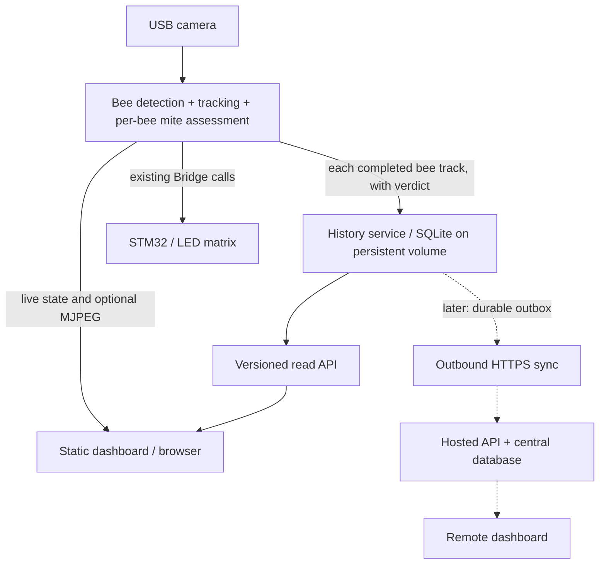

# ArduBeeno history dashboard — architecture draft

Status: proposal, 14 November 2026. The adjacent `index.html` is an interactive mockup with synthetic data. No detector, board, database, or running application has been changed.

Implementation update: the receiver and API-connected dashboard now live in [`dashboard/`](../../dashboard/README.md). The device-local event log/outbox is specified separately in [`mite-device-outbox.md`](../mite-device-outbox.md) for the device agent. The receiving service is distinct from the UNO Q detector. The document below preserves the earlier local-first design exploration; consult the receiver README and its OpenAPI schema for implemented routes.

## What the existing detector actually measures

Reviewed the [detector thread](t3-thread://v2/357d6f81-5525-4b77-93b5-cb2fd3e1eb55/8dffb311-409e-423a-8a82-f8db8ba22022), particularly its latest counter and multi-bee discussion, and the local `applab/ardubeeno/python/{monitor,main,serve}.py` files.

The current pipeline examines a centre crop, combines a mite detector and classifier, and increments `Monitor.count` when the temporal consensus changes from clean to positive. It exposes live `/state` and `/stream`, but keeps its counter in memory. Reset and restart lose the counter. There is no timestamped history to recover retroactively.

The counter is **positive observation episodes**, not the number of individual mites or proven unique bees. One bee can trigger several episodes if consensus flickers; multiple mites on one bee can produce one episode. Keep this legacy metric labelled “Positive observation episodes,” even if the project calls its matrix display “mites counted.” The revised dashboard instead previews the required tracked-bee metrics with synthetic data; the existing counter cannot supply them. Do not sum per-frame boxes, positive frames, or repeated cumulative `/state.count` values.

The thread is moving toward bee detection → full-resolution bee crops → mite assessment → per-bee tracking. This bee detection and tracking stage is now a requirement for the dashboard: count **all observed bee passages**, plus the subset **with detected mites**. Validate both before connecting real data. It still will not measure all mites in the hive, nor a clinical colony infestation rate. Field data and screen demonstrations must remain separate.

## Proposed first version

Run inference, durable storage, a small API, and static frontend on the UNO Q's **Linux side**. Keep the STM32 responsible for its existing matrix display. The browser connects over Ethernet, local Wi-Fi, or an access point; internet is optional. Off-grid does not mean a distant browser can reach the board without a network link.



Use Python FastAPI for the API and buildless HTML/CSS/JavaScript for the initial frontend. FastAPI supports serving [static assets](https://fastapi.tiangolo.com/tutorial/static-files/). Keep one Python history service shared between the plain server and App Lab; adapt the App Lab routes through its existing `WebUI.expose_api`. For the plain runner, replace the hand-written HTTP routing with FastAPI rather than maintaining two different history implementations. Confirm App Lab's installed framework/version and persistent volume mapping before integration.

Use Python's SQLite support with a single writer and short transactions. [SQLite WAL](https://www.sqlite.org/wal.html) permits concurrent readers and a writer, but only one writer at a time. Start with one application worker; multiple server workers must not each open the camera or run inference. No message broker, Redis, or separate database server is needed for the initial single-board build.

## Event recording and reliability

1. Add bee detection and per-bee tracking before the history integration. Emit a `bee_track_completed` event for **every** completed observed track, including those without detected mites. Each event contains UUID, device, session, track ID, sequence, start/end capture timestamps, monotonic offset, assessment (`mites_detected`, `not_detected`, or `uncertain`), assessment quality, model/config revision, source and method. Timestamp the passage at track completion for aggregation. Emit once when a track exits the observation zone or expires; record completion reason. Interrupted tracks on restart must be explicitly marked incomplete and excluded from finalized counts. The legacy positive-transition event can be recorded separately, but cannot supply either bee counter.
2. Insert that event in a short SQLite transaction. Update the session's last sequence in the same transaction. A retry reuses the event ID and sequence. Never infer history by polling the resettable cumulative counter.
3. Only after commit, advance the history-backed total and update the matrix/browser. Preserve a pending event while retrying a transient busy error. Keep JPEG encoding and database writes outside the monitor's condition lock. Measure the latency before adding a bounded writer queue; if a queue is later introduced, document its crash-loss window.
4. On storage failure, keep inference/live preview running but expose a recording fault, the last committed event time, and dropped/pending event counts. Never imply that uncommitted observations were saved. Exclude that interval from recorded coverage.
5. Record recording-health intervals, not just process uptime: camera delivering frames + inference succeeding + storage healthy. Persist a heartbeat every 30 seconds. After a crash, end coverage at the last persisted heartbeat (conservative undercount of coverage, at most one heartbeat interval).
6. Each startup has a new session UUID; UI “reset” becomes a session-display baseline marker. It must never delete historical events or reset the durable event sequence. Retain the existing counter endpoint only as a documented legacy control until clients migrate.

Store timestamps in UTC and keep the apiary's IANA timezone for display and day boundaries. Bucket by local calendar day, including 23/25-hour DST days; query ranges are `[from, to)`. Store monotonic time as well. If the offline board's clock is untrusted, label events `time_quality=untrusted`, show them in a session view, and exclude them from calendar charts until a documented correction maps them to UTC. Never silently backdate them.

## Data model

| Table | Key fields and purpose |
| --- | --- |
| `devices` | `id`, display name, apiary/hive assignment, timezone, last heartbeat. Start with one device and one hive. |
| `sessions` | UUID, device ID, start/end UTC, source (`screen_demo` / `field` / `replay`), capture method, clock quality, firmware version. |
| `config_revisions` | Immutable ID, detector/classifier model hashes, confidence threshold, temporal window/minimum hits, tracking version. |
| `observations` | UUID primary key, device/session, sequence, captured/received UTC, monotonic offset, hive ID at capture, kind, method, score, config revision, optional track ID and image reference. Unique `(device_id, session_id, sequence)` prevents duplicate inserts. |
| `bee_passages` | One row per finalized `(device_id, session_id, track_id)`, event ID, completion time, assessment (`mites_detected` / `not_detected` / `uncertain`), quality and model/config revision. Persist every track, not only positive ones. |
| `coverage_intervals` | Session, start/end UTC, recording state and fault reason; used to distinguish a measured zero from missing data. |
| `session_markers` | Reset/display-baseline actions and operator notes; history remains append-only. |
| `reviews` (later) | Observation, reviewer, accepted/rejected/uncertain, timestamp and note; preserve the original prediction. |
| `outbox` (later) | Event ID, retry count, next attempt and acknowledgement for optional remote sync. |

Index observations on `(device_id, source_kind, method, captured_at_utc)` (source/method may be denormalized from session for query efficiency), and coverage on device/time. Persist outside the app source/container in a verified writable volume. Use the SQLite backup API for consistent backups; do not copy only the main database while WAL is active. Track disk space and bound optional evidence-image retention (e.g. 7 days initially). Keep small event records for the chosen history period; make this a deployment setting, not an implicit deletion job.

Both counters come from the same finalized `bee_passages` set and filters:

- `bees_observed`: count every eligible completed track, including uncertain mite assessments.
- `bees_with_detected_mites`: count only tracks assessed `mites_detected`; never greater than `bees_observed`.
- `bees_assessment_uncertain`: count uncertain assessments separately; do not label them mite-free.

Count a track once regardless of frame count or number of mite boxes. Re-identified tracks and returning bees can duplicate physical bees, so these are observed passages, not unique colony members. Do not backfill track counts from legacy positive episodes. If tracking is unavailable, return `null` and an availability reason for both bee metrics; a measured zero requires working tracking and recorded coverage. Model/version changes must be visible. Do not mix legacy episodes with tracked-bee counts in a time series.

## Read API contract

Prefix: `/api/v1`. Same origin as the page; no permissive CORS. Read endpoints do not change detector settings. The inference code uses the history service directly, so a network ingestion endpoint is unnecessary on the single-board version.

| Route | Response/use |
| --- | --- |
| `GET /devices` | Available devices, hive labels, last seen, recording status. |
| `GET /devices/{id}/status` | Camera/inference/storage health, active source/method, last persisted event, freshness, available metrics, time quality. |
| `GET /devices/{id}/summary?from=...&to=...&tz=...&source=screen_demo&method=bee_tracks_v1` | `bees_observed`, `bees_with_detected_mites`, `bees_assessment_uncertain`, recorded seconds, requested seconds, partial flag and method/model revisions. Return both primary counts together. |
| `GET /devices/{id}/series?...&bucket=day` | Ordered buckets with UTC start/end, local label, both bee counters, uncertain-assessment count, observed seconds and coverage state. Allow hour/day for MVP. |
| `GET /devices/{id}/observations?...&limit=50&cursor=...` | Stable time/ID cursor pagination, not unbounded exports. Filter by source and method. |
| `GET /devices/{id}/observations/{event_id}` | Score, consensus, config revision, timestamp quality and optional evidence. |
| `GET /devices/{id}/export.csv?...` | CSV containing both bee counters, uncertain assessments, coverage and measurement method for the selected source/range. |

Require RFC3339 offsets on `from/to`, valid IANA `tz`, `from < to`, limit 1–200, and a maximum 366-day query. Return 422 for invalid filters, 404 for unknown devices, and an explicit availability flag/reason with null counters when tracking is unavailable, rather than fabricating bee counts. Include `schema_version` and `generated_at` in JSON responses. Use `Cache-Control: no-store` for status; briefly cache historical reads if needed. Poll status every 5 seconds and summaries every 30 seconds while visible, with backoff and last-updated labels. No WebSocket is needed for history.

Example day-series bucket (proposed response, not collected data):

```json
{
  "schema_version": 1,
  "device_id": "uno-q-01",
  "metrics": ["bees_observed", "bees_with_detected_mites", "bees_assessment_uncertain"],
  "method": "bee_tracks_v1",
  "source": "screen_demo",
  "timezone": "Europe/Helsinki",
  "generated_at": "2026-11-14T10:00:00Z",
  "buckets": [
    {
      "start": "2026-11-13T22:00:00Z",
      "end": "2026-11-14T22:00:00Z",
      "local_date": "2026-11-14",
      "bees_observed": 516,
      "bees_with_detected_mites": 12,
      "bees_assessment_uncertain": 4,
      "observed_seconds": 28800,
      "coverage": "partial"
    }
  ]
}
```

Missing coverage yields null for both bee counters, not zero. Fully recorded buckets with no events yield zero. Partially recorded buckets retain their observed count with a coverage warning; do not extrapolate to a full day by default. A current day's count is naturally partial. Never compare partial periods as if exposure were equal. A zero-event API result with no coverage is an empty state, not a clean hive.

## Frontend draft

The mockup offers 24-hour/7-day/30-day ranges, two synthetic device fixtures, a combined stacked chart whose total height is all observed bees and whose red segment is the subset with detected mites, with a Solo picker for all bees or bees with mites, selectable buckets, recorded-time coverage, daily/hourly values for both counts, and CSV export of the selected fixture. A separate architecture tab illustrates data flow. All controls are local; there are no network requests or camera access.

Show these elements in the real page:

- Device/hive selector, source badge (demo versus field), local timezone, range controls, last updated and recording freshness.
- Primary counters: **total bees observed** and **bees with detected mites** for the same period. Secondary: all bees per recorded hour and recording coverage. Include uncertain-assessment counts in details; they remain part of all observed bees. Do not show an infestation percentage until a validated tracked-bee denominator exists.
- Combined bar chart: stack other observed bees plus bees with detected mites (red), so the bar total equals all observed bees without double counting. A Solo picker isolates all observed bees or bees with detected mites and rescales the axis; summary counters and CSV retain both metrics. Include gaps visibly labelled, partial buckets marked, and an accessible exact-values list. Select a bucket to inspect coverage and eventually its evidence events.
- Device health panel that distinguishes “not reachable” from “not recording”; a cached historical number must remain explicitly stale if the board is offline.
- Separate states for loading, first run/no history, measured zero, partial coverage, camera/storage fault, and network error. The mockup includes missing/partial coverage and a stale-device fixture; loading/error states are implementation work.

Do not use red/green thresholds as treatment guidance. No biological alert threshold is justified by the current demo model. Future thresholds must be configured for an agreed, validated metric.

## Optional remote deployment

When distant access becomes necessary, add outbound HTTPS sync from the board to a hosted ingestion API and PostgreSQL. Commit each observation plus outbox row atomically, retry with backoff, and acknowledge batches only after the server commits. Server uniqueness uses device/event identity; retries cannot double count. Sync coverage and config/session metadata too, otherwise remote charts cannot interpret gaps or score changes. Keep records locally when disconnected and surface pending counts.

Provision a separate revocable device credential per board and bind it to the authenticated device; reject spoofed IDs. Browser users authenticate separately and are authorized per apiary. Use TLS on remote connections. Do not expose the existing raw `/config`, `/reset`, `/snapshot`, or camera stream directly to the internet. For LAN use beyond a trusted demo connection, add login and CSRF protection for any future mutations. Cloud hosting alone cannot reach an offline hive.

## Implementation order and completion checks

1. **Bee detection and passage counting:** detect bees, associate detections across frames, assess mites per track, and finalize every track once. Validate clean, positive, uncertain, multiple simultaneous, occluded and returning bees, including track expiration and restart interruption. Then add the history module and migration; persist every finalized track plus timestamps/session/config/coverage. Check restart, display reset, deduplication, disk failure, and consistent backup/restore. Historical collection starts only after this ships.
2. **Versioned API:** implement and share query/service code between App Lab and the standalone runner. Check UTC/local midnight, DST, gaps versus zero, partial days, cursor boundaries, and changing model settings. Verify the persistent volume by restart/redeploy on the UNO Q.
3. **Connect this dashboard:** replace fixture generation with the API adapter; serve static files alongside the API; keep the current live page available as a separate view. Check range/device selection, coverage, stale state, CSV parity, mobile layout and keyboard access.
4. **Board demo:** run a controlled screen sequence, reconcile total tracked passages and positive passages against manually annotated video; verify the matrix count uses the agreed metric; restart midway and confirm history survives. Benchmark inference FPS/latency before and after recording and API reads on the actual board. A tracker-specific validation is required before enabling tracked-bee metrics.
5. **Later:** attach optional evidence/reviews, improve the multi-bee tracker, then add remote sync only if needed. Avoid coupling this work to ongoing model training.

Suggested implementation files: `python/history.py` (event store/query service), `python/history_api.py` (route/schema layer), migrations under `python/migrations/`, and `assets/history.html` plus bundled local assets. These are proposed paths; none is implemented by this draft.

Decisions to confirm during implementation: local-only versus distant access; source/timezone for each device; persistence mapping in App Lab; and validation criteria for the bee tracker. The draft assumes local-first and requires both all observed bee passages and the subset with detected mites. Individual mite totals remain a separate future metric.
